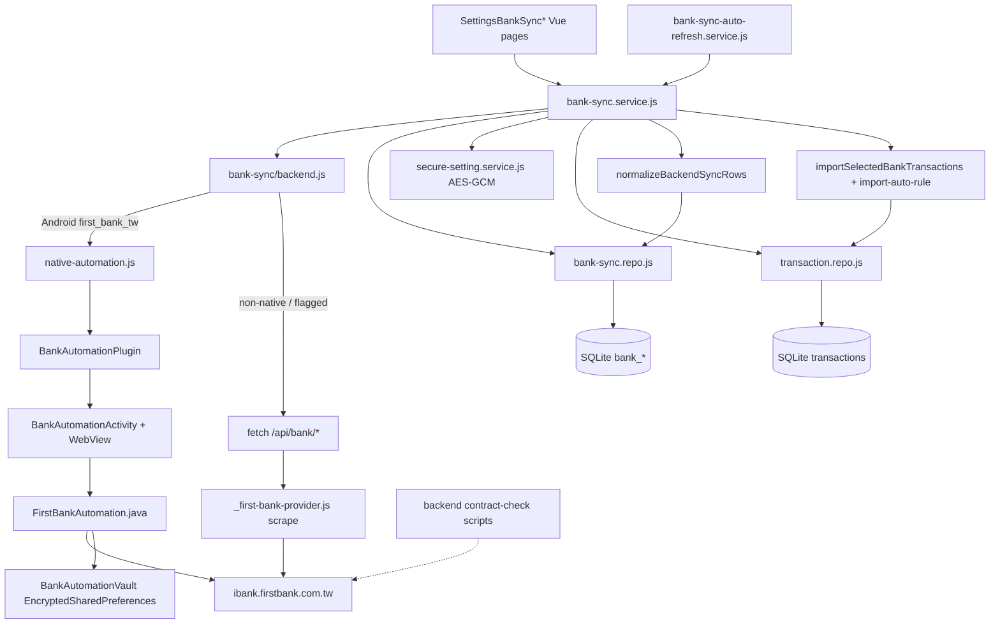
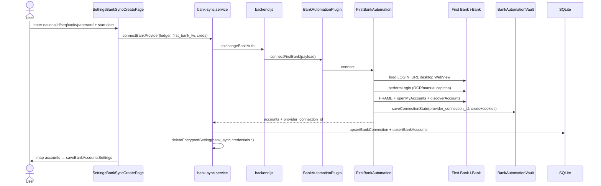
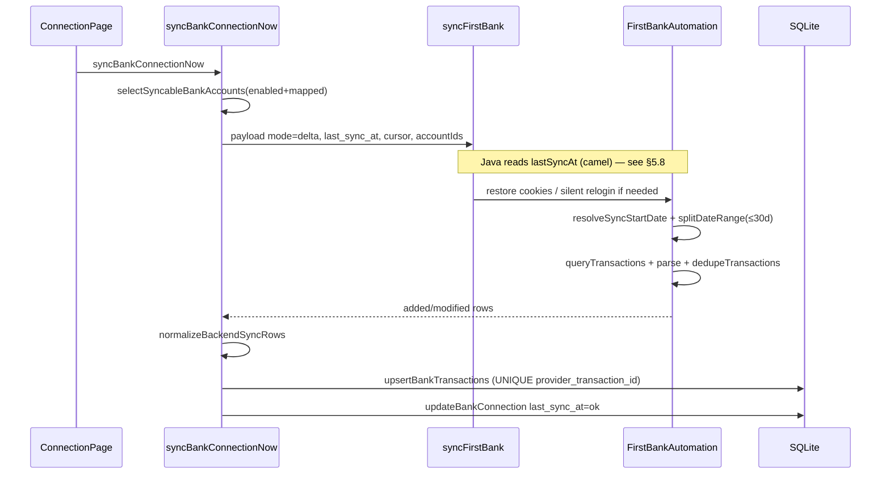
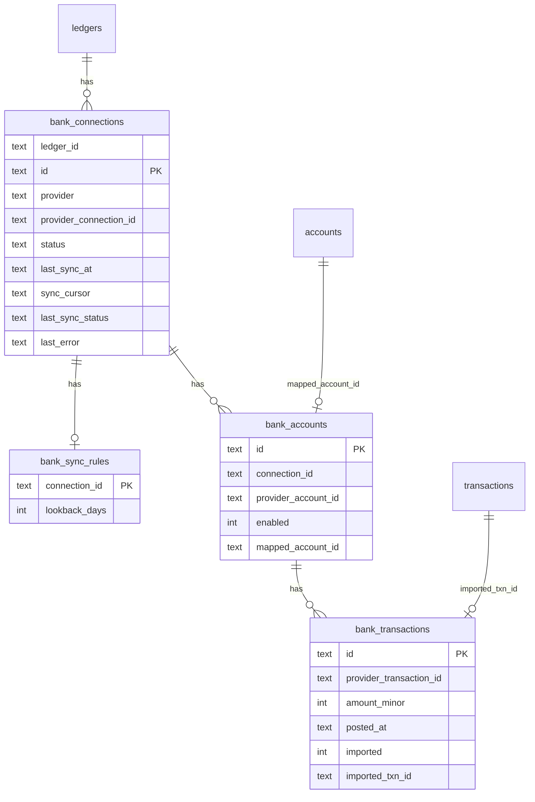

# StrawMB Bank Sync Legacy Architecture Technical Specification

**Document type:** Architecture A — BEFORE / Legacy  
**Status:** Evidence-based audit (read-only)  
**Generated:** 2026-08-16  
**Repo:** `/mnt/data/code/project/StrawCoding/StrawMoneyBook`  
**Baseline / CURRENT HEAD:** `d37467086506a0a544a7e5cdd76f1d9ce428d7a8` (`chore(release): v1.3.138`, 2026-08-15)  
**Working tree:** clean (`git status --porcelain` empty)  
**Optimization code status:** **NOT STARTED** — no Architecture B code exists in tree. Current HEAD **is** Architecture A.

**Errata (2026-08-16):** §5.20 severity of single-provider hardcoding reclassified P0→P1 per stakeholder review; see Optimization Plan v1.1.

> **Separation rule:** This document describes **only** the system as it exists at `d37467086506a0a544a7e5cdd76f1d9ce428d7a8`. Target/refactor designs belong exclusively in `strawmb-bank-sync-optimization-plan.md`.

---

## 0. Snapshot Identity

| Field | Value | Evidence |
|-------|-------|----------|
| BASE_COMMIT | `d37467086506a0a544a7e5cdd76f1d9ce428d7a8` | `git rev-parse HEAD` |
| CURRENT_HEAD | `d37467086506a0a544a7e5cdd76f1d9ce428d7a8` (identical) | same |
| WORKING_TREE | clean | `git status -sb` → `## main...origin/main` |
| Branch | `main` tracking `origin/main` | `git branch -vv` |
| App version | `1.3.138` | `frontend/package.json` |
| Intro of FirstBankAutomation.java | `87eea68` (2026-03-20, v0.21.1) | `git log --diff-filter=A --follow -- FirstBankAutomation.java` |

**Evolution (selected, not exhaustive):**

| Commit | Summary |
|--------|---------|
| `87eea68` | FirstBankAutomation introduced |
| `5ca4086` | Desktop viewport + captcha (SMB-241) |
| `68fdb8b` | WebView harden + CSV fallback (SMB-252) |
| `13ae05d` | Sync contract-check cron (SMB-253) |
| `01a1c89` / `35c624e` | Anchors / vault lookup harden |
| `79b5b5b` | Sync entries → Features advanced section |
| `d374670` | release v1.3.138 |

---

## 5.1 Executive Summary

### Problem solved
Allow a member user on **Android** to link **First Bank (第一銀行) i-Bank**, pull deposit transaction history into a local **review queue**, then import selected rows into the StrawMB ledger as normal transactions/transfers.

### Supported banks (Architecture A)
| Provider ID | Status |
|-------------|--------|
| `first_bank_tw` | **Only production native path** |
| Mock / other | Present as dormant/orphan code; UI connect refuses non-native |

Evidence: `frontend/src/services/bank-sync/backend.js` `PROVIDERS_FALLBACK` L25–31; `bank-sync.service.js` connect refusal L534.

### Sync mode
- **Client-orchestrated**, Android **WebView portal automation** (login + scrape / JSON intercept), **not** Open Banking Open API.
- Optional dormant **server-side HTTP scrape** (`frontend/api/bank/_first-bank-provider.js`) behind env flags — **not** the default UX path.
- **CSV import** fallback into the same `bank_transactions` review pipeline.

### Client / server split
| Concern | Where |
|---------|-------|
| Membership gate | Client `membership.service.js` `assertCanUseBankSync` |
| Feature flag | `VITE_BANK_SYNC_FEATURE_ENABLED` |
| Login + fetch | Android WebView (`FirstBankAutomation.java`) |
| Persist mirror + review | Client SQLite (`bank_*` tables) |
| Import to ledger | Client `bank-sync.service.js` → `transaction.repo` |
| Portal contract monitoring | Backend scripts (`first-bank-portal-contract-check.mjs`) — monitoring only |

### Data storage
- Mirror: client SQLite `bank_connections` / `bank_accounts` / `bank_transactions` / `bank_sync_rules`
- Credentials (native): Android `EncryptedSharedPreferences` vault
- Ledger truth after import: `transactions` (+ `external_ref_id` / idempotency)

### Triggers
- Manual: Settings connection page sync
- Auto: `runBankSyncAutoRefreshIfDue` (10 min cooldown, single-flight per ledger) from app runtime
- CSV: user file pick on connection page

### Largest technical limits
1. Single-bank hardcoding end-to-end (plugin methods, UI form, error codes, Java class).
2. Native incremental window likely degraded by **payload key mismatch** (`last_sync_at` vs `lastSyncAt`) — see §5.8.
3. Live portal fragility (HTML/anchors/captcha); contract-check mitigates detection only.
4. No dedicated Pinia bank-sync store — orchestration lives in service + Vue pages.

### Largest technical debt
- `FirstBankAutomation.java` ≈ **3316 lines** monolith.
- Duplicate provider paths (native + HTTP + playwright + mock) with unclear production ownership.
- Source-gate tests ≠ runtime portal proof.

---

## 5.2 Repository Architecture (real paths)

### Inventory

#### `frontend/src/services/bank-sync/`
| Path | Responsibility | Called by | Dependencies | State | I/O | Side effects |
|------|----------------|-----------|--------------|-------|-----|--------------|
| `shared.js` | Provider ids, hash, vault lookup ids, error classify | service, auto-refresh, tests | none | pure | strings/objects in/out | none |
| `backend.js` | Feature flags, provider list, route native vs HTTP | UI service, FeatureList, router | Capacitor, native-automation, shared | env flags | API-shaped payloads | network or native plugin |
| `native-automation.js` | Capacitor `BankAutomation` wrapper | backend.js | @capacitor/core | none | plugin calls | launches Activity |
| `availability.js` / `availability-core.js` | Staged availability diagnosis | settings UI | membership, backend | pure+wired | codes | none |
| `bank-statement-csv.js` | Parse First Bank CSV → txn shape | service | shared hash | pure | File→rows | none |
| `import-auto-rule.js` | Auto-fill → import plan | service | auto-fill rules | pure | plan | none |
| `local-mock-backend.js` | Mock payloads | tests/scripts only | — | — | — | **not wired** in production backend.js |

#### UI orchestration
| Path | Responsibility |
|------|----------------|
| `frontend/src/ui/services/bank-sync.service.js` | connect/sync/import/disconnect/CSV; encrypted settings for non-native |
| `frontend/src/ui/services/bank-sync-auto-refresh.service.js` | foreground auto sync |
| `frontend/src/core/services/bank-sync-debug.service.js` | in-memory debug traces |
| `frontend/src/core/repositories/bank-sync.repo.js` | SQLite CRUD |
| `SettingsBankSyncPage.vue` / `Create` / `Connection` | UI |
| `FeatureListPage.vue` | Advanced features entry → `/settings/bank-sync` |
| `frontend/src/ui/router/index.js` L180–194 | routes + feature guard |

#### Android
| Path | Responsibility |
|------|----------------|
| `FirstBankAutomation.java` | WebView login, accounts, txns |
| `BankAutomationPlugin.java` | `connectFirstBank` / `syncFirstBank` / `disconnectConnection` |
| `BankAutomationActivity.java` | WebView host, busy lock, timeout |
| `BankAutomationVault.java` | EncryptedSharedPreferences |
| `BankAutomationDebugTrace.java` / `BankAutomationException.java` | diagnostics |

#### HTTP API (dormant for default Android UX)
`frontend/api/bank/{link_session,exchange,sync,disconnect,mark_imported,_utils,_first-bank-provider,_mock-provider,_playwright-provider}.js`

#### Backend monitoring
`backend/src/bank/portal-config.js`, `backend/scripts/first-bank-portal-contract-check.mjs`, `sync-contract-check-run.mjs`, `sync-contract-check-cron.sh`

#### DB migrations
| Path | Role |
|------|------|
| `frontend/src/core/db/migrations/008_bank_sync.sql` | create bank_* |
| `frontend/src/core/db/migrations/019_bank_transaction_metadata.sql` | metadata cols |
| `frontend/src/core/db/migrations/018_shared_sync_deleted_log.sql` | delete-log triggers include bank tables |

#### Tests / scripts (non-exhaustive)
`frontend/test/bank-sync*.js`, `smb278/280/294*bank*`, `FirstBankAutomationCaptchaTest.java`, `BankAutomationThreadAffinityTest.java`, `playwright-bank-sync-settings.mjs`

**Pinia:** No dedicated `bankSync` store found under `frontend/src/**/stores/**` (grep empty). UI calls services directly.

---

## 5.3 Component Architecture (Architecture A — BEFORE)



---

## 5.4 Sequence Diagrams

### A. First bind (Android First Bank) — BEFORE



### B. Manual sync — BEFORE



### C. Auto sync — BEFORE
`runBankSyncAutoRefreshIfDue` → cooldown 10m → single-flight Map → foreach eligible active connection → `syncBankConnectionNow`; stop remaining on credential auth error.

Evidence: `bank-sync-auto-refresh.service.js` L3–6, L55–114.

### D–E. Account / transaction refresh
Same as B: no separate account-only refresh API in Architecture A. Account discovery mainly at **connect**; sync fetches transactions for already-mapped accounts.

### F. Auth expired
Native detects login page during sync → one silent `performLogin` → else `first_bank_session_expired`. JS may mark connection error + reconnect via `shouldRequireReconnectAfterBankSyncError`.

### G. Login failed
`first_bank_login_failed` / captcha manual required with image payload.

### H. Network / timeout
Native: `first_bank_*_timeout`, Activity `bank_automation_timeout`; plugin busy `bank_automation_busy`.

### I. Duplicate transaction
DB UNIQUE `(ledger_id, bank_account_id, provider_transaction_id)` + `findBankTransactionByProviderId` → update or touch `last_seen_at`. Import uses `bank:provider:account:txnId` external_ref.

### J. Partial failure
**NOT VERIFIED** as explicit multi-account partial commit protocol. Sync is per-connection; native loops accounts — failure mid-loop behavior needs Java path reading (account loop throws → whole sync fails). Evidence of atomic multi-account DB txn wrapping all accounts: **NOT VERIFIED** in service (upsert then update connection separately).

---

## 5.5 Authentication Architecture

| Item | Architecture A fact | Evidence |
|------|---------------------|----------|
| Credential fields (First Bank) | nationalId, repeatSeq, userCode, password, captcha | Create page + Java `connect` |
| Native storage | EncryptedSharedPreferences `strawmoneybook.bank_automation.v1` | `BankAutomationVault.java` L13–28 |
| Vault payload | provider, connectionId, nationalId, repeatSeq, userCode, password, initialSyncStartDate, cookieHeader, updatedAt | `FirstBankAutomation.connect` ~L174–184 |
| Client encrypted settings | `bank_sync.credentials.<connectionId>` AES-GCM — **deleted after native connect** | `bank-sync.service.js` L185–196, L529 |
| Remote session | base64url cookie state; prelogin TTL 10m | `_first-bank-provider.js` |
| OAuth / Open Banking | **No evidence** | — |
| Session refresh | Cookie restore + silent relogin once | Java sync L220–285 |
| Logout/revoke | `disconnect` clears vault + cookies; DB status revoked | Java disconnect + service |
| Multi-device | Vault is **device-local**; no cloud credential sync evidenced | — |
| Plaintext password in SQLite | **No** — vault encrypted prefs; SQLite stores connection metadata only | migrations 008 |

---

## 5.6 Account Synchronization

| Topic | Fact |
|-------|------|
| Discovery | At connect: `openMyAccounts` → `discoverAccounts` |
| Identity | `provider_account_id` UNIQUE per `(ledger_id, connection_id, provider_account_id)` |
| Mapping | User sets `mapped_account_id` → ledger `accounts.id` |
| Syncable | `enabled=1` AND mapped (`selectSyncableBankAccounts`) |
| Balance refresh | Balance may appear on txn rows as `balance_minor`; dedicated balance-only sync **NOT VERIFIED** |
| Disabled | `enabled=0` skipped |
| New accounts after connect | **NOT VERIFIED** automatic rediscovery on sync — user may need reconnect |

---

## 5.7 Transaction Synchronization

```
Remote portal rows
  → FirstBankAutomation.query/parse (JSON intercept preferred, DOM table.CnbTable fallback)
  → providerTransactionId (or fbtxn_ hash)
  → JS normalizeBackendSyncRows
  → upsertBankTransactions
  → bank_transactions (imported=0 review)
  → importSelectedBankTransactions → transactions
```

| Field | Handling |
|-------|----------|
| provider_transaction_id | Required unique per bank account |
| amount_minor | Integer minor units |
| posted_at | ISO/text from parser |
| status | pending\|posted\|reversed (schema) |
| metadata | transaction_type, note, summary, balance_minor (mig 019) |
| refund/reversal | schema supports `reversed`; live mapping quality **NOT VERIFIED** beyond schema |
| transfer detection | import-auto-rule / plan may create transfer | 

Hash fallback (native): `fbtxn_` + hash(`accountId|postedAt|amountMinor|summary|note`) — `FirstBankAutomation.java` ~L1412–1418.

---

## 5.8 Incremental Sync Algorithm (BEFORE)

**Intended (JS):**
```
mode: 'delta'
cursor: connection.sync_cursor
last_sync_at: connection.last_sync_at
lookback_days: rule.lookbackDays (0–30, default 3)
```

**Native actual:**
```
lastSyncAt = payload.optString("lastSyncAt")  // camelCase ONLY
start = resolveSyncStartDate(initialSyncStartDate, lastSyncAt, cursor)
windows = splitDateRange(start, today) // MAX_WINDOW_DAYS=30
for each window: query portal
```

**Evidence of mismatch (P0):**
- JS sends `last_sync_at` — `bank-sync.service.js` L647
- Java reads `lastSyncAt` — `FirstBankAutomation.java` L214
- `native-automation.js` does **not** remap keys
- Therefore native `lastSyncAt` is typically **empty**
- With empty lastSyncAt, `resolveSyncStartDate` returns **cursorDate** (`initialStartDate` from cursor) — L2085–2102
- Effect: each sync tends to **re-fetch from initial start date** (chunked in 30-day windows); correctness relies on dedupe, not true incremental checkpoint

`lookback_days`: used by remote provider; **native Java does not read lookback** (grep only lastSyncAt/cursor).

Pseudo-code (as implemented):
```
syncBankConnectionNow(ledger, connectionId):
  accounts = selectSyncableBankAccounts(...)
  payload = { last_sync_at, cursor, lookback_days, accountIds, ... }
  res = syncNativeFirstBank(payload)  # Java ignores last_sync_at key
  rows = normalize(res.added + res.modified)
  upsertBankTransactions(...)
  updateBankConnection(lastSyncAt=now, syncCursor=next or keep)
```

---

## 5.9 Deduplication Architecture

| Layer | Key | Evidence |
|-------|-----|----------|
| Native in-batch | `providerAccountId + ":" + providerTransactionId` | Java `dedupeTransactions` ~L541–551 |
| SQLite | `UNIQUE (ledger_id, bank_account_id, provider_transaction_id)` | `008_bank_sync.sql` |
| Upsert logic | `findBankTransactionByProviderId` then insert/update/touch | `bank-sync.repo.js` L455–507 |
| Ledger import | `bank:{provider}:{providerAccountId}:{providerTransactionId}` | `buildSourceRef` L287–288 |
| CSV | `fbcsv_` + hash(...) | `bank-statement-csv.js` |

**If same bank txn synced twice:** second upsert finds existing provider id → update content if diff else touch `last_seen_at` — should **not** create second mirror row (DB unique).

**Race conditions:**
- Concurrent sync: Activity `isBusy` + auto-refresh inflight Map mitigate; multi-ledger parallelism possible.
- Connect→immediate sync vault race: mitigated by vault `commit()` (Vault L48–52).
- Import vs sync concurrent: **NOT VERIFIED** explicit lock.

---

## 5.10 Database Architecture



Review queue = `bank_transactions` where `imported=0` (no separate table).

---

## 5.11 Data Ownership

| Data | Source of Truth | Conflict rule |
|------|-----------------|---------------|
| Bank account list / masks | Bank portal (at connect) | Local mapping fields user-owned |
| Balance | Bank (when present on rows) | Display/mirror; ledger balances from ledger txs |
| Bank transaction mirror | Bank via sync upsert | Provider id wins for mirror update |
| User category / notes on ledger txn | User / auto-fill rules | Import creates ledger row; later bank re-sync does not auto-rewrite imported ledger row (**verify:** imported flag prevents re-import; mirror may still update) |
| Sync metadata | Client DB | last_sync_at / cursor local |

---

## 5.12 State Management

**No Pinia bank store.** Pattern:

```
Remote → native/HTTP → bank-sync.service → bank-sync.repo → SQLite
UI ← service getters / page-local reactive state ← SQLite reads
```

Loading/error: page-local + connection `last_sync_status` / `last_error`.

---

## 5.13 Concurrency

| Control | Mechanism | Evidence |
|---------|-----------|----------|
| Auto-refresh single-flight | `inflightByLedger` | auto-refresh L5–6 |
| Cooldown | 10 minutes | L3 |
| Native busy | `BankAutomationActivity.isBusy` | Plugin L51–53 |
| Vault flush | `commit()` | Vault L48–52 |
| Double button | UI-dependent; busy reject helps | — |

Known historical races (account store / transaction submit) are **out of bank-sync module** unless shared write queue used — bank repo uses project SQLite write patterns (**NOT VERIFIED** whether bank upserts use `sqlite-write-queue`).

---

## 5.14 Error Handling (Taxonomy mapping)

Architecture A uses **First-Bank-prefixed codes**, not the generic names in the brief. Mapping:

| Brief name | Architecture A examples |
|------------|-------------------------|
| AUTH_FAILED | `first_bank_login_failed`, `*_credentials_required` |
| SESSION_EXPIRED | `first_bank_session_expired`, `first_bank_legacy_reconnect_required` |
| BANK_UNAVAILABLE / portal | `first_bank_portal_contract_failed`, `*_page_mismatch` |
| PARSE / query | `first_bank_transaction_query_failed` |
| CAPTCHA | `first_bank_captcha_manual_required` |
| BUSY / TIMEOUT | `bank_automation_busy`, `*_timeout` |
| FEATURE | `bank_sync_feature_disabled`, membership `BANK_SYNC_ACCESS` |

Classify: `classifyFirstBankSyncFailure` → `portal_changed` | `reconnect` | `retry` (`shared.js`).

---

## 5.15 Retry / Timeout

| Layer | Behavior |
|-------|----------|
| Captcha OCR | Multiple attempts then manual required |
| Silent relogin | Once per sync if login page detected |
| Auto-refresh | No exponential backoff; cooldown only |
| HTTP provider | **NOT VERIFIED** full retry policy in this audit pass |
| Activity | overall automation timeout → `bank_automation_timeout` |

Retry storm: mitigated by cooldown + busy lock; not fully eliminated for manual spam.

---

## 5.16 Security Architecture

| Area | Fact |
|------|------|
| At rest (Android creds) | EncryptedSharedPreferences AES |
| At rest (SQLite) | Device filesystem; app sandbox; **not** SQLCipher evidenced for bank tables |
| In transit | HTTPS to bank portal via WebView |
| Logs | DebugTrace exists; must not log passwords — **policy intent**; full audit of all log sinks **NOT VERIFIED** exhaustively |
| Env | `VITE_BANK_SYNC_*`, shared client key header |
| Remote session token | base64 cookie blob if HTTP path enabled — risk if enabled in prod |

---

## 5.17 UI / UX Architecture

Routes: `/settings/bank-sync`, `/new`, `/:id`  
Entry: FeatureList「進階功能」  
States encoded via connection status + toasts + captcha panel + availability matrix  
i18n: zh-TW / en / ja keys under `settings_bank_sync*`

---

## 5.18 Observability

| Capability | Status |
|------------|--------|
| DebugTrace steps | Yes (native + JS attach) |
| bank-sync-debug.service | In-memory operation traces |
| Structured syncId metrics | **NOT VERIFIED** / largely absent as product metrics |
| Contract-check stats | Backend `.server-data/sync-contract-check-stats.json` |

---

## 5.19 Testing

| Kind | Examples | Gap |
|------|----------|-----|
| node:test | bank-sync.service, shared, csv, auto-refresh, import-auto-rule | — |
| Source-gate | android-source, ui-source, backend-source | Not runtime |
| Android unit | CaptchaTest | Not full login E2E |
| Playwright | playwright-bank-sync-settings | Settings UX |
| Live portal E2E | **NOT VERIFIED** in CI as deterministic | Real bank needed |

---

## 5.20 Legacy Architecture Problems

### P0 Critical (Correctness)
1. **Native incremental key mismatch (`last_sync_at` vs `lastSyncAt`)**  
   Evidence: `bank-sync.service.js` L647 vs `FirstBankAutomation.java` L214; `native-automation.js` no remap. Impact: re-fetch from initial date; load/time; portal risk. Root: JS↔Java DTO contract drift.  
   **Severity rationale (v1.1 review):** This is the only P0 *correctness* defect blocking reliable incremental sync.

### P1 High
2. **Architecture blocker — single-provider hardcoding** *(downgraded from P0 in v1.1 review)*  
   Not a production correctness bug while only First Bank is required; blocks Hua Nan / multi-bank. Evidence: Plugin FirstBank-only methods; Create page fields; `isFirstBankProviderId` gates.
3. **Partial / connection-level checkpoint ambiguity** *(highlighted for Architecture B)*  
   Checkpoint today is connection-scoped (`bank_connections.last_sync_at` / `sync_cursor`). Partial multi-account failure cannot be expressed safely — either under-fetch or over-refetch.
4. **3316-line FirstBankAutomation monolith** — maintainability / regression cost.  
5. **Dormant multi-path providers** (HTTP/playwright/mock) — confusion, attack surface if flags flipped.  
6. **Virtual keyboard / future banks** — Architecture A has no shared driver.

### P2 Medium
7. Source-gate tests ≠ runtime confidence.  
8. No Pinia sync state machine — UI inconsistency risk.  
9. `lookback_days` unused on native path.

### P3 Low
10. i18n/error strings tightly First-Bank-named.  
11. mark_imported HTTP no-op.

> **Review note (2026-08-16):** Stakeholder reclassified «single-provider hardcoding» from P0 Critical → P1 Architecture blocker. Legacy narrative otherwise unchanged.

---

## Source Evidence Index (selected)

| Claim | File | Symbol / lines |
|-------|------|----------------|
| HEAD / clean tree | git | `d374670…`, porcelain empty |
| Provider fallback | `frontend/src/services/bank-sync/backend.js` | L25–31, L166–175 |
| Sync payload | `frontend/src/ui/services/bank-sync.service.js` | L589–719 |
| lastSyncAt read | `FirstBankAutomation.java` | L214, L2085–2102 |
| Vault | `BankAutomationVault.java` | L13–52 |
| Schema | `008_bank_sync.sql`, `019_*.sql` | full |
| Dedupe UNIQUE | `008_bank_sync.sql` | bank_transactions UNIQUE |
| Auto refresh | `bank-sync-auto-refresh.service.js` | L3–6, L55+ |
| Membership | `membership.service.js` | `assertCanUseBankSync` ~L927 |

---

*End of Architecture A (Legacy) Technical Specification.*
