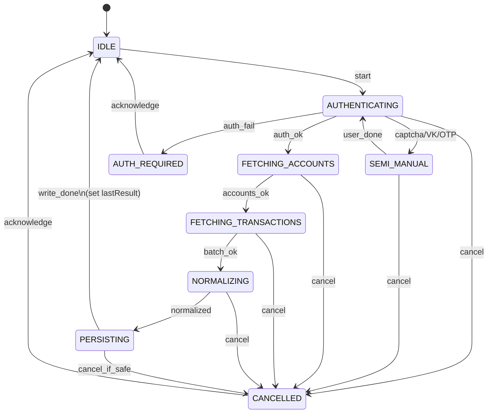
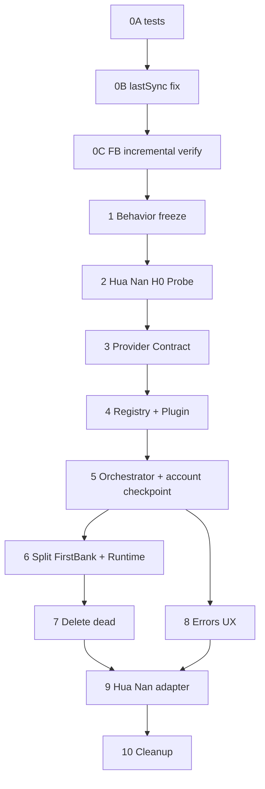

# StrawMB Bank Sync Optimization & Refactoring Plan

**Version:** **v1.1** (+ **v1.1.1 spec patch** required before Phase 0A)
**Patch:** see `strawmb-bank-sync-optimization-plan-v1.1.1.md` — Watermark / Identity Stability / Dual-key Precedence (architecture specification only — **no product code changes**)  
**Document type:** Architecture B — AFTER / TARGET + Engineering TDD  
**Supersedes:** v1.0 Optimization Plan (2026-08-16 earlier draft, score ~7.8/10)  
**Status:** Spec revision incorporating stakeholder review — **do not start full rewrite until this v1.1 is accepted**  
**Generated:** 2026-08-16  
**Repo HEAD (product code unchanged):** `d37467086506a0a544a7e5cdd76f1d9ce428d7a8`  
**Working tree (product):** clean at audit time; this file is documentation only

## v1.1 Change Log (spec-only)

| # | Stakeholder finding | v1.1 resolution |
|---|---------------------|-----------------|
| 1 | P0 fix ordered *after* registry/refactor in Migration Plan, contradicting Recommended Order | **Unified:** Phase 0A–0C fix incremental contract **before** any architecture refactor |
| 2 | PARTIAL_FAILED + connection-level checkpoint conflict | **Account-level checkpoint**; connection holds aggregate only; define `PARTIAL_SUCCESS` |
| 3 | Hua Nan H0 Probe too late (Phase 7) | **Probe before** Provider Contract / Registry |
| 4 | Universal fingerprint including `balanceMinor` | **Provider-owned** `buildTransactionIdentity()` → opaque `providerTransactionId` |
| 5 | Single-bank hardcoding listed P0 Critical | **Downgrade** to P1 architecture blocker (Legacy §5.20 patched) |
| 6 | CANCELLED from IDLE; state mixes runtime + history | **Cancel only from in-flight phases**; split Runtime Phase vs Persisted Sync Result |
| 7 | REST-like retry unsafe for portal automation | **Provider-aware** operation capabilities: SAFE_RETRY / NO_RETRY / REAUTH / USER_INTERACTION_REQUIRED |

**Explicit non-goal of v1.1:** implement code. Next step after acceptance = Phase 0A long-task only.

---

## Locked product decisions (unchanged from intakes)

Round 1 `pi_dac580dbe64dec5d` + Round 2 `pi_9d664070c0cfd0e8` remain authoritative for product intent (`full_rewrite`, generic plugin, schema wizard, delete dead remote, HNCB, opt-in auto-import, etc.).  
**v1.1 only changes *how/when* those goals are engineered**, not the product goals themselves.

---

## 6. Change Audit (unchanged facts)

```
BASE_COMMIT = CURRENT_HEAD = d37467086506a0a544a7e5cdd76f1d9ce428d7a8
WORKING_TREE product = clean
Architecture B code = NOT IN TREE
```

v1.0 Change Matrix still valid as *planned* work; **execution order rewritten below**.

---

## 7. Optimization Goals (refined priorities)

| Priority | Goal | Note |
|----------|------|------|
| **P0 Correctness** | Fix `last_sync_at` ↔ `lastSyncAt` contract | Must land before refactor |
| **P1 Reliability** | Account-level checkpoint + PARTIAL_SUCCESS | Architecture B必改 |
| **P1 Architecture** | Multi-bank after **evidence** (FB + HN probe) | Abstraction from two banks, not FB alone |
| **P1 Security/cleanup** | Delete dead remote scrapers after audit | per `delete_dead` |
| **P2 Maintainability** | Split 3316-line FirstBankAutomation | After contracts stable |
| **P2 UX** | Runtime phase + persisted lastResult | |
| Defer | SQLCipher, iOS, Open Banking, Kafka/etc. | Anti-overengineering |

---

## 8. Target Architecture B (v1.1)

```text
                 BankSyncOrchestrator
                         │
           ┌─────────────┼─────────────┐
           │             │             │
     ProviderRegistry  SyncLock    ErrorMapper
           │
   ┌───────┴────────┐
   │                │
FirstBankProvider  HuaNanProvider
   │                │
   │  buildTransactionIdentity()
   │  declareOperationRetryPolicy()
   │  credentialSchema / capabilities
   └───────┬────────┘
           │
  BankAutomationRuntime (shared WebView/OCR/Intercept/Vault/VK probe helpers)
           │
        WebView → Bank Portal

Provider DTO (opaque providerTransactionId)
     → Normalizer (domain shape only)
     → Account-level checkpoint read/write
     → Idempotent Upsert (UNIQUE)
     → SQLite transaction (per account or explicit partial commit rules)
     → Import Pipeline (opt-in)
     → Ledger
```

**Boundaries (stakeholder-aligned):**
- **Provider** = bank differences (login, navigation, identity, retry capability)
- **Orchestrator** = sync lifecycle, locking, aggregation, error mapping to UI
- **Repository** = consistency / persistence
- **UI** = render Runtime Phase + Persisted Sync Result only

---

## 9. Provider Abstraction (v1.1 — evidence-first)

**Do not freeze** the Provider interface until **Hua Nan H0 Probe** completes.

Design input set:
1. First Bank (known production path)
2. Hua Nan probe report (login/VK/OTP/captcha/account list/txn fields)

Conceptual contract (draft until after probe):

```ts
interface BankProvider {
  id: string
  credentialSchema: CredentialField[]
  authenticate(ctx): Promise<AuthResult>
  refreshSession(ctx): Promise<SessionResult>  // may be REAUTH / USER_INTERACTION
  fetchAccounts(ctx): Promise<AccountDTO[]>
  fetchTransactions(ctx, query): Promise<TxnDTO[]>
  /** Provider-owned: never a universal fingerprint helper in Orchestrator */
  buildTransactionIdentity(rawRow): string  // → providerTransactionId
  operationRetryPolicy(op: PortalOperation): RetryCapability
  logout(ctx): Promise<void>
}
```

Orchestrator **must not** know whether `providerTransactionId` is bank-native id, composite key, or hash.

---

## 10. Sync Orchestrator (v1.1)

Entrypoints unchanged in spirit: `syncBankConnection`, internal per-account sync.

**New:** connection sync = fan-out to account syncs with **per-account checkpoint**.

```text
Connection Sync
 │
 ├─ Account A → checkpoint A → upsert A → status A
 ├─ Account B → checkpoint B → upsert B → status B
 └─ Account C → FAIL → checkpoint C unchanged → status C=error
 ↓
 Aggregate → PARTIAL_SUCCESS | COMPLETED | FAILED
 Persist connection.last_attempt_at / last_full_success_at / overall status
 Persist lastResult summary for UI
```

---

## 11. Sync State Machine (v1.1)

### 11.1 Runtime Phase (ephemeral)



**Forbidden:** `IDLE → CANCELLED` (v1.0 error). Cancel only from in-flight phases.

### 11.2 Persisted Sync Result (durable, not a phase)

```ts
lastResult = {
  status: 'COMPLETED' | 'PARTIAL_SUCCESS' | 'FAILED' | 'CANCELLED' | 'AUTH_REQUIRED',
  finishedAt: string,
  fetched: number,
  inserted: number,
  updated: number,
  duplicated: number,
  accountResults: Array<{ accountId, status, errorCode?, checkpoint? }>,
}
```

UI reads `phase` for spinner copy and `lastResult` for banners after return to IDLE.

---

## 12. Concurrency (unchanged intent)

Busy lock + single-flight + syncSessionId/generation to ignore stale completions. Account-level sync may serialize accounts on one WebView (realistic for portal) — parallel account WebViews **not** required in v1.1.

---

## 13. Transaction Idempotency (v1.1)

### Provider-owned identity

```text
FirstBankProvider.buildTransactionIdentity(raw)
HuaNanProvider.buildTransactionIdentity(raw)
        ↓
DTO.providerTransactionId  (opaque to Orchestrator)
        ↓
SQLite UNIQUE (ledger_id, bank_account_id, provider_transaction_id)
        ↓
Ledger external_ref = bank:{provider}:{providerAccountId}:{providerTransactionId}
```

### Rules
- Prefer bank-native: transactionId / referenceNo / sequenceNo / stable portal key  
- Composite only from **stable** bank fields (posting date, amount, bank ref) — **provider decides**  
- **Do not** put `balanceMinor` into identity (balance is representation, not identity)  
- **Do not** rely on mutable `summary`/`note`/`description` alone  
- **No** `UniversalTransactionFingerprint()` in Orchestrator

---

## 14. Incremental Sync + Checkpoint (v1.1 — 必改)

### Schema ownership

```text
bank_connections
  overall status
  last_attempt_at
  last_full_success_at          -- only when ALL enabled accounts succeeded
  last_error (aggregate)
  -- keep sync_cursor only if still needed for connection-level metadata; prefer migrate away

bank_accounts
  last_success_sync_at          -- NEW (checkpoint)
  sync_cursor                   -- NEW or migrate from connection
  last_sync_status              -- ok|error|idle
  last_error
```

### PARTIAL_SUCCESS semantics

| Case | Account checkpoints | Connection `last_full_success_at` | Connection overall |
|------|---------------------|-----------------------------------|--------------------|
| All accounts OK | advance each | update to now | COMPLETED / ok |
| Some OK, some FAIL | advance **only** successful accounts | **unchanged** | PARTIAL_SUCCESS |
| All FAIL | none advanced | unchanged | FAILED |
| Auth required mid-way | none advanced after auth break; prior account successes already committed per policy | unchanged unless all done | AUTH_REQUIRED or PARTIAL_SUCCESS |

**Per-account atomicity:** for each account: `BEGIN upsert txns + update account checkpoint COMMIT`.  
Failed account: no checkpoint advance → next sync resumes from that account’s last success (with optional safety overlap window).  
Successful accounts: do **not** re-pull full history solely because a sibling failed.

### P0 contract fix (still required, Phase 0B)

JS ↔ Java must agree on `lastSyncAt` **and** accept `last_sync_at` during transition; dual-read in Java; dual-write in JS; regression test. Eventually account-level fields replace connection-only incremental signal.

---

## 15. Atomic Persistence (v1.1)

**Not** one big connection transaction that advances a single checkpoint after mixed results.

```text
for account in syncable:
  try:
    BEGIN
      upsert transactions(account)
      update account checkpoint
    COMMIT
    mark account OK
  except:
    ROLLBACK
    mark account FAIL (checkpoint untouched)
aggregate → lastResult + connection overall fields
```

---

## 16. Database Optimization (v1.1)

### Before
`008_bank_sync.sql` + `019` — connection-level `last_sync_at` / `sync_cursor`.

### After (additive)
- `bank_accounts.last_success_sync_at TEXT`
- `bank_accounts.sync_cursor TEXT`
- `bank_accounts.last_sync_status TEXT`
- `bank_accounts.last_error TEXT`
- `bank_connections.last_attempt_at TEXT`
- `bank_connections.last_full_success_at TEXT`
- `bank_connections.auto_import_enabled INTEGER` (locked product choice)
- Migration + backfill: copy connection `last_sync_at` → each enabled account as initial checkpoint (best-effort)
- Rollback: drop new columns / ignore in code behind flag

---

## 17. Error Architecture

Domain errors unchanged in spirit; map provider codes → AUTH_REQUIRED / SESSION_EXPIRED / CAPTCHA_REQUIRED / PORTAL_CHANGED / NETWORK / PARSE / DATABASE / PARTIAL_SUCCESS / BUSY / UNKNOWN.  
Legacy `first_bank_*` compatibility map for one release (`generic_only_codes`).

---

## 18. Retry Policy (v1.1 — provider-aware)

```text
RetryCapability:
  SAFE_RETRY
  NO_RETRY
  REAUTH
  USER_INTERACTION_REQUIRED
```

| Operation (examples) | Typical capability |
|----------------------|--------------------|
| portal load / navigation | SAFE_RETRY (bounded) |
| fetchTransactions query | SAFE_RETRY |
| password / login submit | **NO_RETRY** blind; maybe REAUTH path once |
| captcha submit | NO_RETRY / USER_INTERACTION_REQUIRED |
| VK / OTP | USER_INTERACTION_REQUIRED |
| session expired mid-sync | REAUTH once, then fail |

Orchestrator consults `provider.operationRetryPolicy(op)` — **not** a global REST 3× retry on every failure.

---

## 19–25. Security / UI / Progress / Observability / Tests / Mock / Perf

Same intent as v1.0 with these deltas:
- Progress & metrics keyed by **account** where possible  
- Tests must cover PARTIAL_SUCCESS checkpoint isolation  
- MockProvider must simulate one account fail + siblings success  
- Performance win primarily from Phase 0B + account checkpoints (stop full-history refetch)

---

## 26. Migration Plan (v1.1) — **authoritative order**

> Resolves v1.0 contradiction: Migration Plan and Recommended Order are now **one sequence**.

### Phase 0A — Regression harness
- Goal: failing/characterizing test for `last_sync_at` vs `lastSyncAt`  
- DoD: test proves mismatch; documents current behavior  
- **No** broad refactor  

### Phase 0B — Fix incremental DTO contract
- Dual-key write (JS) + dual-key read (Java)  
- **Mandatory:** wire First Bank lookback (default 3 days) into native; see v1.1.1 §1  
- DoD: unit/source test green; First Bank device smoke shows window advances  

### Phase 0C — Verify First Bank incremental
- Manual/device: second sync does not re-pull entire initial range (or overlap-only)  
- DoD: evidence in stage report  

### Phase 1 — Behavior Freeze
- Snapshot Architecture A (+0B fix) as golden; expand node/android source tests  
- DoD: freeze checklist signed  

### Phase 2 — Hua Nan H0 Probe  (**moved earlier**)
- Login fields, VK, captcha, OTP, account list, txn field stability, JSON vs DOM  
- Output: probe report + draft `HuaNanProvider.buildTransactionIdentity` strategy  
- DoD: written evidence; **no** interface freeze before this  

### Phase 3 — Provider Contract from FB + HN evidence
- Finalize interface, DTO, retry capabilities, identity ownership  
- DoD: design ADR in docs; still minimal code  

### Phase 4 — Provider Registry + Generic Plugin API
- Registry; `connectBank/syncBank/disconnectBank`; transitional FirstBank aliases  
- Schema-driven wizard for First Bank first  
- DoD: First Bank parity on device  

### Phase 5 — Orchestrator + account-level checkpoint + PARTIAL_SUCCESS
- Fan-out sync; migrations; lastResult; state machine v1.1  
- DoD: MockProvider partial test; FB device partial simulation if possible  

### Phase 6 — Split FirstBankAutomation + Shared Runtime
- Behavior parity  
- DoD: CaptchaTest + smoke  

### Phase 7 — Delete dead remote providers
- After grep/prod flag audit  
- DoD: Android-only path  

### Phase 8 — Errors / UX / i18n generic codes
- DoD: playwright matrix  

### Phase 9 — Hua Nan adapter (H1/H2)
- Login (semi-manual if probe requires) → accounts → txns → review → opt-in import  
- DoD: real device ≥1 txn  

### Phase 10 — Cleanup
- Remove aliases; docs; APK; release notes  
- DoD: closeout gates  

---

## 27. Atomic Modification List (adjusted)

P0-only first:
- `[MODIFY]` `bank-sync.service.js` — emit `lastSyncAt` + `last_sync_at`
- `[MODIFY]` `FirstBankAutomation.java` — read both keys
- `[CREATE/MODIFY]` tests asserting contract

Later phases as in v1.0 file list (registry, plugin, HN, delete dead, migrations for account checkpoints, etc.) — **not** started in v1.1 doc pass.

---

## 28. Dependency Graph (v1.1)



---

## 29–30. Comparison / Data Flow

v1.0 tables still directionally correct; **add**:
- Checkpoint: connection-only → **account-level**  
- Identity: universal hash → **provider-owned**  
- Probe: late → **before contract**  
- Retry: REST → **capability enum**

---

## 31. Risk Assessment (updated)

| Risk | Mitigation in v1.1 |
|------|--------------------|
| Refactoring over broken incremental | Phase 0B first |
| Partial sync data gaps | Account checkpoints |
| Wrong generic interface | Probe before contract |
| False identity collisions | Provider identity; no balance in fingerprint |
| Login retry lockout | NO_RETRY on submit |

---

## 32–33. DoD / Acceptance

Add explicit DoD items:
- [ ] Account checkpoint isolation under PARTIAL_SUCCESS  
- [ ] No universal fingerprint helper in Orchestrator  
- [ ] Provider retry capabilities consulted  
- [ ] HN probe report exists before interface freeze  
- [ ] P0 dual-key fix merged before Phase 4+  

Acceptance matrix at v1.1 plan time: all Architecture B items remain **NOT IMPLEMENTED**; Phase 0B fix **NOT IMPLEMENTED** (bug still present in `d37467086506a0a544a7e5cdd76f1d9ce428d7a8`).

---

## 34–35. Debt / Roadmap

Unchanged spirit; **Now** = Phase 0A–0C only until accepted.

---

## 39. Recommended Implementation Order (v1.1) — **same as §26**

### P0
1. 0A characterizing/failing contract test  
2. 0B dual-key fix  
3. 0C First Bank incremental verification  

### P1
4. Behavior freeze  
5. Hua Nan H0 Probe  
6. Provider Contract ADR  
7. Registry + generic plugin  
8. Orchestrator + account checkpoints + PARTIAL_SUCCESS  

### P2
9. Split FirstBank + runtime  
10. Delete dead providers  
11. Generic errors/UX  
12. Hua Nan adapter  

### P3
13. Cleanup / APK / docs  

---

## 40. Executive Verdict (v1.1)

1. **Largest problem:** JS↔Java incremental contract break (P0 correctness), then connection-level checkpoint inadequacy for partial sync, then premature abstraction risk.  
2. **True bugs:** lastSync key mismatch; lookback unused on native; connection checkpoint vs partial accounts.  
3. **Debt / blockers:** FirstBank hardcoding = **P1 architecture blocker** (not P0 bug); 3316-line monolith; dead providers.  
4. **Necessary now:** Phase 0A–0C only, then probe, then contract — **not** full rewrite kickoff.  
5. **Defer:** iOS, SQLCipher, Open Banking, infra toys.  
6. **Overengineering risk:** reduced vs v1.0 by evidence-first provider design + account checkpoint instead of clever universal fingerprint.  
7. **Production-grade?** Still Partial for FB; multi-bank not ready.

### Grades (unchanged honesty)

| Area | A now | B if v1.1 DoD met |
|------|-------|-------------------|
| Architecture | D | B |
| Data Consistency | C | B+ |
| Reliability | C | B |
| Security | B- | B+ |
| Maintainability | D | B |
| Testability | C | B |
| UX | C | B |
| Observability | D | C+/B- |

**Stakeholder gate:** do **not** authorize Hermes/worker to「全部照企畫實作」until this **v1.1** is accepted. After acceptance, authorize **Phase 0A** only as first atomic task.

---

*End of Optimization Plan v1.1 (spec-only).*
